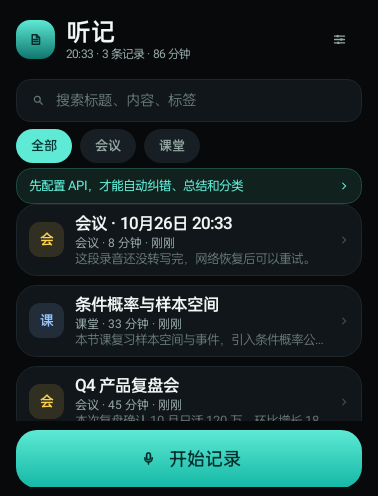
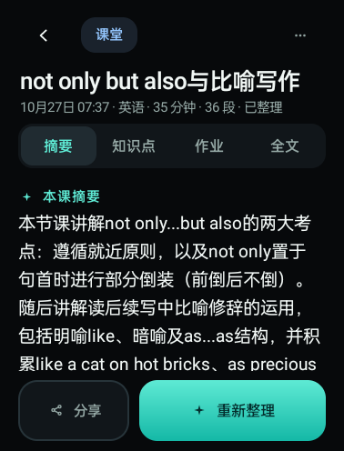
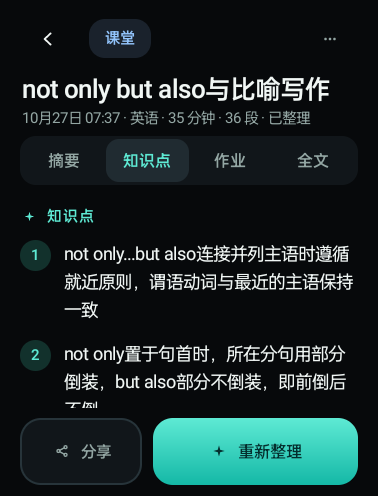
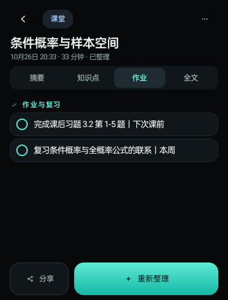
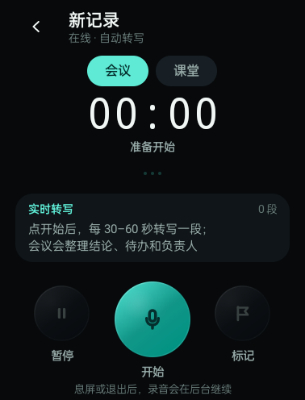
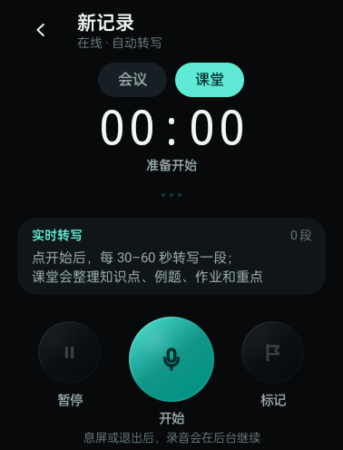
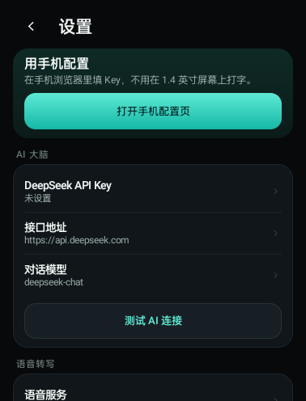
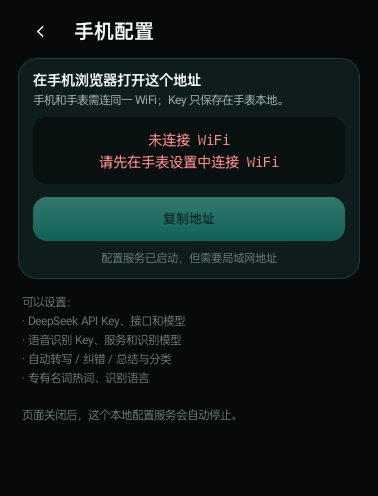

# 听记 · 手表会议与课堂记录

为 **32 位 Android 智能手表** 做的录音记录 App：录会议、录课堂，自动分段转写，再用 DeepSeek 一类的 API 做纠错、摘要、要点、待办和分类。

已在 **OPPO OWW221（Android 11，armeabi-v7a，378×496）** 真机验证完整链路：

```text
录音 → 2 段 WAV → ASR 转写 → 纠错 → 摘要 / 分类 / 要点 / 待办
```

协议层用本地 mock 的 OpenAI 兼容服务联调；填入真实 DeepSeek / 硅基流动 Key 后走同一套接口。真机测试中，授予 OPPO 的“始终允许录音”后，息屏录音、后台转写和 AI 整理可以继续。



## 为什么适合手表

- **32 位可用**：纯 Java/DEX，不打包任何 `.so`，直接运行在 armeabi-v7a 上；minSdk 23（Android 6+）。
- **小屏布局**：针对约 300dp 宽的表盘重新排版，大按钮、单手可点、深色 AMOLED 界面。
- **录音不占内存**：16 kHz 单声道连续录音，按 30–60 秒自动切成 WAV 片段；不在内存里堆整场录音。
- **后台继续**：前台服务 + 通知栏控制，退出录音页后仍可继续（需系统允许麦克风后台使用）。
- **课堂 / 会议分开整理**：不是只换标题，AI 模板和详情页会按类型切换。
- **首次启动引导**：先调整界面缩放，再看 4 页使用教程，最后进入主页
- **新的界面基准**：原来的 125% 缩放现在作为 100%，录音页按更窄的 240dp 宽重排，按钮不重叠、图标更大
- **学科自动分类**：课堂笔记自动识别数学/语文/英语/物理/化学/生物/历史/地理/政治/计算机/科学/其他；点“学科”筛选，同科目会分组显示。

## 功能

### 录音

- 会议 / 课堂两种记录类型
- 开始、暂停、继续、结束
- 手动“标记”重点，记录时间点
- 30–60 秒自动分段；优先在停顿处切，减少切断句子
- 录音电平波形、实时显示已转写段数和最近一段文字
- 实时转写使用滚动淡入/模糊过渡，自动追随最新一段
- 通知栏显示录音时长，可暂停 / 继续 / 结束
- 结束录音后自动转写、纠错、总结和分类

### 课堂笔记（重点）

课堂模式会单独要求 AI 输出：

- **本课摘要**：这节课讲了什么、核心方法/结论
- **知识点**：定义、公式、关键结论
- **例题 / 案例**：题目要点和解法
- **作业与复习**：作业、预习、复习任务和截止时间
- **重点 / 难点 / 易错点**
- **知识点标签**
- **学科自动归类**：数学、语文、物理、化学等，旧记录会用本地关键词补全

详情页的标签也会从会议的“要点 / 待办”切换为“知识点 / 作业”。

| 课堂摘要 | 知识点 | 作业 |
| --- | --- | --- |
|  |  |  |

### 会议记录

- 摘要
- 关键要点
- 待办事项（负责人｜事项｜时间）
- 结论 / 决定
- 标签

### 管理与分享

- 课堂笔记按学科自动分类；点主页“学科”筛选，同科目分组
- 详情页可手动修改学科
- 首次启动引导：界面缩放 → 使用教程 → 主页
- 本地 SQLite 保存记录
- 按标题、转写、摘要、标签搜索
- 全部 / 会议 / 课堂筛选
- 长按卡片删除
- 分享或复制 Markdown 全文
- 修改标题、类型；重新整理

## 截图

| 会议录音 | 课堂录音 | 设置 |
| --- | --- | --- |
|  |  |  |

手机辅助配置页：



## 安装

APK：

```text
out/TingJi-v1.0.4.apk
```

安装：

```bash
adb install -r out/TingJi-v1.0.4.apk
```

也可以把手表连电脑，用“安卓手表 ADB 实用工具箱”安装。

## 首次启动

第一次安装会按顺序进入：

1. **界面缩放**：先拖到文字/按钮舒服的大小，下一步
2. **使用教程**：4 页，介绍录音、AI 整理、课堂笔记、权限隐私
3. **主页**

以后可在 **设置 → 重新查看使用教程** 再看教程；缩放仍在 **设置 → 外观与反馈 → 界面缩放**。

## 首次使用

1. 打开 **听记**。
2. 点 **开始记录**，允许麦克风权限。
   - OPPO 手表还会弹出一个“听记需要录音或通话录音，是否允许”的系统窗口，选 **始终允许**。
   - 不选“始终允许”时，息屏后系统可能拒绝创建录音轨。
3. 首次建议先用 **设置 → 用手机配置** 填好 API，再开始正式记录。

## 配置 API

### 需要两个 Key

| Key | 用途 | 默认服务 |
| --- | --- | --- |
| DeepSeek API Key | 纠错、摘要、知识点、待办、分类 | `https://api.deepseek.com` |
| 语音识别 Key | 把 WAV 转成文字 | 硅基流动 `TeleAI/TeleSpeechASR` 或 `Qwen/Qwen3-ASR-1.7B` |

> DeepSeek 开放平台只有文本/图片能力，**没有 `/audio/transcriptions` 语音转写接口**。所以语音识别要单独接一个 OpenAI 兼容的 ASR 服务；文字智能功能仍然全部由 DeepSeek 驱动。

### 方式 A：手机配置（推荐）

1. 手表和手机连同一个 WiFi。
2. 手表：**设置 → 用手机配置**。
3. 手表显示一个 `http://192.168.x.x:8787/?t=...` 地址。
4. 手机浏览器打开这个地址，填写：
   - DeepSeek API Key、接口地址、模型
   - 语音识别 Key、服务、模型
   - 是否自动转写 / 纠错 / 总结分类
   - 专有名词热词
5. 点 **保存到手表**。
6. 手表页面会显示“配置已保存”，此时可以关闭手机页面。

配置服务只在手表这个页面打开时监听局域网，带随机 token，关闭页面即停止。

### 方式 B：手表上直接填

**设置 → AI 大脑 / 语音转写**，逐项点进去填。API Key 支持密码输入；长 Key 还是建议用手机配置。

### 推荐参数

DeepSeek：

```text
接口地址：https://api.deepseek.com
对话模型：deepseek-flash
```

`deepseek-flash` 是当前官方主模型（V4.1 Flash），默认开启思考模式。听记会在纠错/总结/JSON 提取时显式关闭 thinking，避免思考内容占满 `max_tokens` 导致正文为空。旧模型名 `deepseek-chat` 仍可作为兼容项手动填写，但不再是默认。

硅基流动 ASR：

```text
接口地址：https://api.siliconflow.cn/v1/audio/transcriptions
识别模型：TeleAI/TeleSpeechASR（快、轻）
        或 Qwen/Qwen3-ASR-1.7B（中文识别更稳，按需选择）
识别语言：留空（模型自动判断；Whisper 可填 zh）
```

也可以切 OpenAI Whisper、Groq Whisper，或选“自定义接口”填任意 OpenAI 兼容的 `/audio/transcriptions` 地址。

语音模型下拉里已经内置：

- 硅基流动 · TeleSpeechASR
- 硅基流动 · Qwen3-ASR-1.7B
- OpenAI Whisper
- Groq Whisper
- 自定义接口

识别模型不要选 CosyVoice、IndexTTS 等 TTS 模型——那些是“让 AI 说话”，不能用来听你说话。

### 专有名词 / 热词

在 **设置 → 自动整理 → 专有名词 / 热词** 填人名、公司名、课程名、产品名、缩写等，用逗号或顿号分隔。纠错时会把它们作为优先词表。

## 使用

### 记录一场会议

1. 主页点 **开始记录**。
2. 选 **会议**。
3. 点中间麦克风开始。
4. 需要时点 **暂停**，点 **标记** 记录重点。
5. 点红色 **结束**。
6. 自动转写、纠错、总结；完成后进入详情页。
7. 在“摘要 / 要点 / 待办 / 全文”之间切换，或分享 Markdown。

### 记录一节课

1. 主页点 **开始记录**。
2. 选 **课堂**。
3. 开始录音。页面会提示“课堂会整理知识点、例题、作业和重点”。
4. 结束后进入课堂详情：
   - **摘要**：本课摘要、重点/难点/易错点、知识点标签
   - **知识点**：定义、公式、关键结论 + 例题/案例
   - **作业**：作业与复习任务
   - **全文**：纠错后 / 原转写切换

### 录音中

- 中间红色按钮 = 结束（会先确认）
- 左 = 暂停 / 继续
- 右 = 标记重点（写入时间点）
- 退出录音页后录音继续；通知栏可回来
- 建议录音时保持手表有电；长时间录音会消耗电量

### 失败与重试

- 没有网络 / ASR 失败：该段 WAV 会保留，记录显示“待重试”
- 详情页底部点 **重试转写**
- 转写成功但 AI 失败：文字仍在，点 **AI 整理 / 重新整理**
- 删除记录时会同时删除本地片段

## 数据与隐私

- 记录、转写、摘要：本地 SQLite，不上传
- API Key：Android Keystore AES/GCM 加密保存；部分手表 Keystore 异常时退回本地混淆存储
- 音频：只发送到你配置的 ASR 服务；某段转写成功后删除该段 WAV
- 文字：发送到你配置的 DeepSeek / OpenAI 兼容接口做纠错、总结和分类
- 无统计、无广告、无第三方 SDK
- 手机配置页只在当前页面打开时监听局域网，关闭即停止

## 构建

不依赖 Gradle，使用本机 Android build-tools：

```bash
cd TingJi
bash build.sh
```

脚本默认使用仓库上一级的工具链：

```text
../build/toolchain/android-28/android.jar
../build/toolchain/bt34/aapt2.exe
../build/toolchain/bt34/zipalign.exe
../build/toolchain/bt34/apksigner.bat
../build/r8.jar
../build/debug.keystore
```

输出：

```text
build/TingJi-v1.0.4.apk
out/TingJi-v1.0.4.apk
```

当前 APK 使用 debug keystore 签名，适合个人侧载；上架应用商店请换正式签名。

## 目录

```text
TingJi/
  java/com/wrist/tingji/
    core/       录音服务、ASR、AI、SQLite、设置、手机配置
    ui/         主页、录音页、详情页、设置、配置页
    util/       UI、图标、波形、开关
  res/          图标与字符串
  docs/         截图
  tools/        mock_api.py（本地联调用）、make_icons.py
  out/          最终 APK
```

## 界面缩放

- 手表默认以原来的 **125%** 作为新的 **100%**
- 旧设置会自动迁移：原来 125% → 100%，原来 100% → 80%，视觉大小不变
- 当前范围约为 60%–104%
- 首次启动会先让你调整缩放，再进教程
- 录音页已针对新的 100% 重排，按钮和文字不再互相遮挡；录音/暂停/标记图标也放大了

## 已知限制

- 语音识别和 AI 都需要网络；没有离线模型
- 极长录音会切成很多 30–60 秒片段，转写和 AI 整理需要时间
- 首次在 OPPO 手表录音必须选“始终允许”，否则息屏后可能无法创建录音轨
- 不同手表的麦克风、降噪和后台策略不同，录音效果会有差异
- 课堂的公式/符号识别效果取决于 ASR 和原文清晰度；可在热词里补充课程专有名词
- 当前只适配竖屏小屏；圆形表盘未做单独避让

## 说明

这是个人侧载工具，与 DeepSeek、硅基流动、OpenAI、Groq 均无隶属关系。API 费用由各服务商按你的用量收取。
